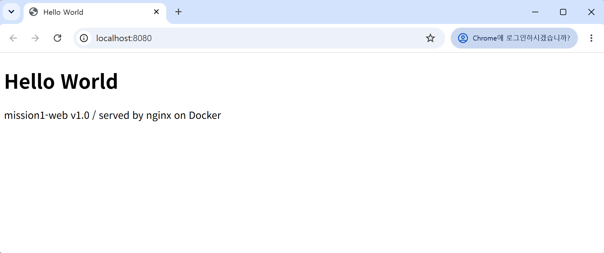
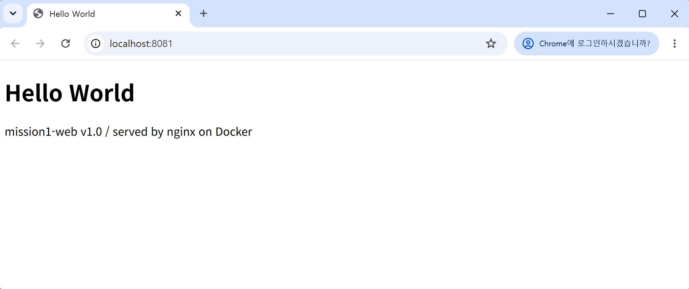

# mission1 

## 1) 프로젝트 개요
터미널(CLI), Docker, Git/GitHub로 개발 작업 환경을 직접 구성하고, 터미널에 입력한 명령과 출력 결과로 검증한다. 출력 전체는 `logs/`에 저장했다.

## 2) 실행 환경
| 항목 | 내용 |
|---|---|
| OS | Windows 11 Pro (10.0.26200) |
| 터미널/쉘 | Git Bash, PowerShell / 리눅스 명령 실습: WSL2 Ubuntu의 bash |
| Docker | Docker Desktop 4.98.0 / Docker Engine 29.9.2 |
| Git | git version 2.56.0.windows.2 |

## 4) 검증 방법과 결과
| 항목 | 입력한 명령 | 확인 내용 | 로그 |
|---|---|---|---|
| 작업 폴더 구성 | `cd /c/Users/user/Desktop` → `git clone https://github.com/cmc33sh-ux/mission1.git` → `cd mission1` → `mkdir -p logs site bind-demo` → `pwd` | `mission1` 폴더 위치와 하위 폴더 생성 | [00](logs/00_workspace_setup.txt) |
| 터미널 조작 | `pwd`, `ls -la`, `mkdir -p ~/practice`, `cd ~/practice`, `touch empty.txt`, `echo 'hello linux' > note.txt`, `cat note.txt`, `cp note.txt copy.txt`, `mv copy.txt renamed.txt`, `rm`, `rmdir` | 생성·복사·이동·이름 변경·삭제 결과가 `ls`와 `cat`에 반영됨 | [04](logs/04_terminal_permission.txt) |
| 권한 | `ls -l note.txt` → `chmod 755 note.txt` → `chmod 644 note.txt` → `chmod 600 note.txt` / `ls -ld a` → `chmod 700 a` → `chmod 755 a` | 변경 전/후 권한 문자열 비교 (`-rw-r--r--` → `-rwxr-xr-x` → `-rw-------`, 디렉토리 `drwxr-xr-x` → `drwx------`) | [04](logs/04_terminal_permission.txt) |
| Docker 설치·점검 | `docker --version`, `docker info` | `Docker version 29.9.2`, `Server Version: 29.9.2` 출력 (데몬 동작) | [01](logs/01_docker_check.txt) |
| Docker 기본 운영 | `docker images`, `docker pull nginx:alpine`, `docker run -d --name ops-nginx nginx:alpine`, `docker ps`, `docker logs ops-nginx`, `docker stats --no-stream`, `docker stop ops-nginx`, `docker ps -a`, `docker rm ops-nginx` | 실행 중(`Up`) → 종료(`Exited (0)`) 상태 변화, 로그·자원 사용량 확인 | [02](logs/02_docker_ops.txt) |
| 컨테이너 실습 | `docker run --rm hello-world`, `docker run --name ubuntu-once ubuntu bash -c "ls / && echo hello-from-ubuntu"`, `docker run -d --name ubuntu-keep ubuntu sleep infinity`, `docker exec ubuntu-keep ls /` | `Hello from Docker!` 출력, ubuntu 내부 명령 결과 확인 | [03](logs/03_containers.txt) |
| Dockerfile 빌드 | `docker build -t mission1-web:1.0 .`, `docker images mission1-web` | 빌드 성공, 이미지 `mission1-web:1.0` 생성 | [05](logs/05_dockerfile_portmap.txt) |
| 포트 매핑 | `docker run -d -p 8080:80 --name web-8080 mission1-web:1.0`, `docker run -d -p 8081:80 --name web-8081 mission1-web:1.0`, `curl -s http://localhost:8080` | 두 포트 모두 `HTTP 200`과 페이지 응답. 매핑 없이 실행한 컨테이너는 `HTTP 000`(접속 불가) | [05](logs/05_dockerfile_portmap.txt) |
| 바인드 마운트 | `docker run -d --name bind-test -p 8090:80 -v "C:\Users\user\Desktop\mission1\bind-demo:/usr/share/nginx/html:ro" nginx:alpine`, `curl -s http://localhost:8090` (호스트에서 `index.html` 수정 전/후) | 컨테이너 재시작 없이 응답이 `BEFORE` → `AFTER`로 변경 | [06](logs/06_mount_volume.txt) |
| 볼륨 영속성 | `docker volume create mydata`, `docker run -d --name vol-test -v mydata:/data ubuntu sleep infinity`, `docker rm -f vol-test`, `docker run -d --name vol-test2 -v mydata:/data ubuntu sleep infinity`, `docker exec vol-test2 cat /data/hello.txt` | 컨테이너 삭제 후에도 `hi from volume` 유지 | [06](logs/06_mount_volume.txt) |
| Git 설정 | `git config --global init.defaultBranch main`, `git config --list` | `user.name`, `init.defaultbranch=main` 확인 (이메일은 마스킹) | [07](logs/07_git_config.txt) |
| GitHub | `git clone`, `git remote -v`, `git push origin main` | 원격 저장소 `origin` 연결과 push 반영 | [00](logs/00_workspace_setup.txt) |

- **포트 매핑 접속 화면** (브라우저, 주소창에 포트 표시): `localhost:8080`과 `localhost:8081` 모두 `Hello World` 페이지가 열린다.

  
  
- **컨테이너 종료/유지**: `docker run ... bash -c "..."`는 명령이 끝나면 컨테이너도 종료(`Exited (0)`)된다. `sleep infinity`로 실행한 컨테이너는 계속 `Up`이고, `docker exec`는 그 안에 명령을 추가로 실행하므로 끝나도 컨테이너가 유지된다.
- **Dockerfile 커스텀**: 기존 베이스 `nginx:alpine`에 `LABEL`(이미지 정보), `ENV APP_ENV=dev`(설정 분리), `COPY site/ ...`(기본 페이지 교체), `HEALTHCHECK`(응답 점검)를 추가했다.
